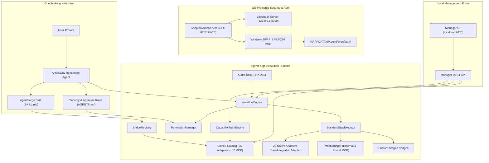

# AgentForge

[](https://github.com/HamzaShaikhAI/AgentForge/actions/workflows/ci.yml)
[](https://opensource.org/licenses/MIT)
[](https://nodejs.org)
[](https://www.typescriptlang.org)

**Local-first integration and workflow platform for Google Antigravity.**

AgentForge equips **Google Antigravity** with deterministic execution, native service bridges, universal Model Context Protocol (MCP) server presets, fine-grained permission enforcement, human-in-the-loop approval checkpoints, durable multi-step workflows, and a local Manager UI dashboard.

---

## 1. Why AgentForge?

Large Language Model reasoning agents excel at planning, analysis, and code synthesis, but interacting with external tools and third-party APIs presents critical architectural challenges:
- **Uncontrolled Side Effects:** Autonomous agents executing arbitrary shell commands or remote API calls risk accidental publishing, destructive deletions, or quota burn.
- **Credential Sprawl:** Hardcoding API keys or scattering tokens across `.env` files compromises security and leaks secrets into source control.
- **Fragmented Tooling:** Third-party services, local CLI utilities, and external MCP servers each require separate protocol adapters and error handlers.

**AgentForge solves this by serving as Antigravity's deterministic execution runtime:**
- **Antigravity Remains the Brain:** Antigravity handles high-level cognitive reasoning, prompt interpretation, and user dialogue.
- **Deterministic Permission Boundaries:** Actions with external or destructive side effects halt at cryptographic approval checkpoints before execution.
- **Local-First & OS-Protected:** Tokens are encrypted using Windows DPAPI (or AES-256-GCM on Unix) in user storage outside the repository — zero centralized brokers, zero external telemetry.
- **Unified Catalog:** Merges 25 native bridges, 52 external MCP server presets, and custom user-generated bridges into a single searchable capability catalog.

---

## 2. Key Capabilities & V1 Highlights

- **Deterministic 5-Tier Permissions:** Classifies every action (`read`, `local-write`, `external-write`, `publish`, `destructive`) with mandatory operator approval checkpoints for high-risk operations.
- **OS-Protected Credential Isolation:** Zero tokens in git. Credentials write strictly to `%APPDATA%\AgentForge\auth\` or `~/.config/agentforge/auth/` using Windows DPAPI or AES-256-GCM.
- **Native Desktop OAuth 2.0 (RFC 8252 & RFC 7636):** Direct loopback authentication (`http://127.0.0.1:8910/callback`) with SHA-256 PKCE verifiers, DNS-rebinding protection, and automatic secret redaction.
- **25 Production Native Adapters:** Standardized on `BaseIntegrationAdapter` covering Filesystem, HTTP, SQLite, Git, YouTube, Docker, GitHub API, GitLab, Jira, Linear, Sentry, AWS S3, Cloudflare, PostgreSQL, Redis, MongoDB, Slack, Discord, Notion, SendGrid, Twilio, Brave Search, Tavily, Memory, and Stripe.
- **52 Universal MCP Presets:** Verified, versioned configurations across 8 categories (Dev Tools, Cloud, Databases, Search, Communication, Productivity, AI/ML, Specialized APIs) with stdio and http transport support.
- **15 Advanced Platform Features:** Dynamic step conditions, pipe filters, environment variable interpolation, step timeout overrides, cancellation cleanup hooks, dry-run mode, cryptographic audit hash chains, webhook ingress triggers, token bucket rate limiting, scoped delegation tokens, encrypted vault backups, adapter health monitoring, interactive step debugging, Antigravity skill generation, and structured run artifacts/logs.
- **4 Flagship Production Workflows:** Autonomous Release Pipeline, Multi-Channel Publishing, Incident Response & Triage, and Data Pipeline & Local Database Sync.
- **Local Manager Dashboard:** Responsive single-page web portal on `http://localhost:9470` featuring CSS design tokens, dark/light theme switching with persistence, and 12 operational views.

---

## 3. Truthful Capability Matrix

AgentForge maintains strict truthfulness — distinguishing tested local implementations from external dependencies, unconfigured services, and future horizons:

| Component / Layer | Scope / Actions | Security Tier | Operational Status | Verification Evidence |
| :--- | :--- | :--- | :--- | :--- |
| **Local Filesystem** | `read-file`, `write-file`, `stat-file`, `list-dir`, `delete-file` | `read` – `destructive` | **Tested & Verified** | Path containment & schema enforcement |
| **HTTP Client** | `get`, `post`, `put`, `delete` | `read` – `destructive` | **Tested & Verified** | SSRF loopback protections & timeout limits |
| **SQLite Database** | `read-query`, `write-query`, `list-tables`, `schema-inspect` | `read` – `local-write` | **Tested & Verified** | Local SQLite execution & memory database tests |
| **Git & GitHub CLI** | `repo-info`, `status-check`, `branch-list`, `log-inspect`, `diff-review`, `changelog-prepare` | `read` – `publish` | **Tested & Verified** | Real local Git CLI integration & dry-run push checks |
| **Stdio MCP Runtime** | Child process spawning, JSON-RPC 2.0 handshake, `tools/list`, `tools/call`, `ping` | Dynamic | **Tested & Verified** | Real Node.js child process stdio integration tests |
| **Universal MCP Presets** | 52 Curated server presets across 12 categories | Dynamic | **Schema Validated** | 100% schema compliance; live API tests require user tokens |
| **25 Native Adapters** | Standardized `BaseIntegrationAdapter` framework | Dynamic | **Contract Tested** | 9/9 adapter tests passing; auto-registered with executor |
| **15 Platform Features** | Audit hash chains, conditions, pipe filters, rate limiter, delegation tokens | Core Runtime | **Tested & Verified** | 25/25 feature acceptance tests passing |
| **Workflow Engine** | DAG ordering, conditions, filters, recovery, approval checkpoints | Core Runtime | **Tested & Verified** | Non-idempotent reconciliation states & replay guards |
| **Manager UI** | 12 Operational views, dark/light theme, REST API | Read / Admin | **Tested & Verified** | Zero external CDN dependencies, loopback security |
| **Google Zero-Config Sign-In** | Direct RFC 8252 PKCE loopback authentication | Core Auth | **Externally Blocked** | Application code ready; awaits Google Cloud publisher registration (Developer Mode active) |
| **Enterprise Horizons (V2–V4)** | OPA policy engine, multi-tenant isolation, agent mesh | Future Roadmap | **Proposed / Planned** | See [docs/ROADMAP.md](docs/ROADMAP.md) for milestone specifications |

*For complete capability details and action schemas, see [docs/INTEGRATIONS.md](docs/INTEGRATIONS.md) and [docs/V1_KNOWN_LIMITATIONS.md](docs/V1_KNOWN_LIMITATIONS.md).*

---

## 4. Architecture Overview



---

## 5. Quick Start

### Installation

```bash
# Clone the repository
git clone https://github.com/HamzaShaikhAI/AgentForge.git
cd AgentForge

# Install dependencies
npm install

# Compile TypeScript
npm run build

# Run complete test suite (326 tests)
npm test
```

### Launching the Manager UI

Start the local Manager dashboard:

```bash
npm run manager
```

Open your browser to `http://localhost:9470` to explore:
- **Overview & Truth Matrix**: Live health, verified capabilities, and system diagnostics.
- **Universal MCP Marketplace**: 52 presets ready for one-click installation.
- **Native Bridges**: Inspect schemas, actions, and permissions for all 25 native adapters.
- **Workflow Studio & Runs**: Execute, monitor, debug, and approve multi-step workflows.

### Google OAuth Authorization (YouTube)

To authenticate Google OAuth for YouTube operations:

```bash
# Basic inspection permissions (read-only)
npm run auth youtube

# Video uploading permissions (requests explicit consent)
npm run auth youtube -- --upload

# Check verified OAuth status
npm run auth status
```

---

## 6. Flagship Production Workflows

AgentForge ships with 4 end-to-end production workflows:

1. **Autonomous Release Pipeline (`wf-autonomous-release`)**:
   Inspects repository state $\rightarrow$ checks working tree $\rightarrow$ verifies package manifest $\rightarrow$ prepares changelog $\rightarrow$ creates tag $\rightarrow$ approval checkpoint $\rightarrow$ pushes release tag to remote.
2. **Multi-Channel Content Publishing (`wf-multichannel-publish`)**:
   Verifies local video asset $\rightarrow$ approval checkpoint $\rightarrow$ uploads to YouTube via resumable protocol $\rightarrow$ broadcasts release announcement to Discord and Slack.
3. **Incident Response & Triage (`wf-incident-triage`)**:
   Queries Sentry crash telemetry $\rightarrow$ evaluates severity condition $\rightarrow$ approval checkpoint $\rightarrow$ opens tracking issue on GitHub $\rightarrow$ alerts on-call engineering channel in Slack.
4. **Data Pipeline & Local Database Sync (`wf-data-pipeline-sync`)**:
   Reads dataset from filesystem $\rightarrow$ stages records into local SQLite $\rightarrow$ notifies remote sync endpoint via HTTP $\rightarrow$ executes guaranteed cleanup hook.

---

## 7. Documentation Index

- [Architecture & Design (`docs/ARCHITECTURE.md`)](docs/ARCHITECTURE.md)
- [V1 Final Verification Audit (`docs/V1_FINAL_VERIFICATION.md`)](docs/V1_FINAL_VERIFICATION.md)
- [V1 Implementation Report (`docs/V1_IMPLEMENTATION_REPORT.md`)](docs/V1_IMPLEMENTATION_REPORT.md)
- [V1 Acceptance Traceability Matrix (`docs/V1_ACCEPTANCE_MATRIX.md`)](docs/V1_ACCEPTANCE_MATRIX.md)
- [V1 Known Limitations & Boundaries (`docs/V1_KNOWN_LIMITATIONS.md`)](docs/V1_KNOWN_LIMITATIONS.md)
- [V1 Release Qualification Checklist (`docs/V1_RELEASE_CHECKLIST.md`)](docs/V1_RELEASE_CHECKLIST.md)
- [Release Engineering & Qualification Process (`docs/RELEASE_PROCESS.md`)](docs/RELEASE_PROCESS.md)
- [Product Roadmap & Release Horizons (`docs/ROADMAP.md`)](docs/ROADMAP.md)
- [Google OAuth Publisher Readiness (`docs/OAUTH_PUBLISHER_READINESS.md`)](docs/OAUTH_PUBLISHER_READINESS.md)
- [Installation Guide (`docs/INSTALLATION.md`)](docs/INSTALLATION.md)
- [Integrations Reference (`docs/INTEGRATIONS.md`)](docs/INTEGRATIONS.md)
- [Security Model (`docs/SECURITY.md`)](docs/SECURITY.md)
- [Support & Troubleshooting (`docs/SUPPORT.md`)](docs/SUPPORT.md)

---

## 8. License

MIT License. See [LICENSE](LICENSE) for details.
