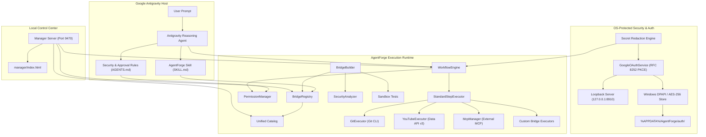

# AgentForge

[](https://github.com/HamzaShaikhAI/AgentForge/actions/workflows/ci.yml)
[](https://opensource.org/licenses/MIT)
[](https://nodejs.org)
[](https://www.typescriptlang.org)

**Local-first capability and integration harness for Google Antigravity.**

AgentForge provides structured bridge manifests, external Model Context Protocol (MCP) connectivity, deterministic permission gating, durable multi-step workflow execution, and a local web dashboard for **Google Antigravity**.

---

## 1. Why AgentForge?

Large Language Model reasoning agents excel at planning, analysis, and code synthesis, but interacting with external tools and third-party APIs presents critical architectural challenges:
- **Uncontrolled Side Effects:** Autonomous agents executing arbitrary shell commands or remote API calls risk accidental publishing, destructive deletions, or quota burn.
- **Credential Sprawl:** Hardcoding API keys or scattering tokens across `.env` files compromises security and leaks secrets into source control.
- **Fragmented Tooling:** Third-party services, local CLI utilities, and external MCP servers each require separate protocol adapters and error handlers.

**AgentForge solves this by serving as Antigravity's deterministic execution runtime:**
- **Antigravity Remains the Brain:** Antigravity handles high-level cognitive reasoning, prompt interpretation, and user dialogue.
- **Deterministic Permission Boundaries:** Actions with external or destructive side effects halt at cryptographic approval checkpoints before execution.
- **Local-First & OS-Protected:** Tokens are encrypted using Windows DPAPI (or AES-256-GCM on Unix) in user storage outside the repository—zero centralized brokers, zero external telemetry.
- **Unified Catalog:** Merges native bridges, external MCP tools, and custom user-generated bridges into a single searchable capability catalog.

---

## 2. Key Features

- 🛡️ **Deterministic 5-Tier Permissions:** Classifies every action (`read`, `local-write`, `external-write`, `publish`, `destructive`) with mandatory operator approval checkpoints for high-risk operations.
- 🔐 **OS-Protected Credential Isolation:** Zero tokens in git. Credentials write strictly to `%APPDATA%\AgentForge\auth\` or `~/.config/agentforge/auth/` using Windows DPAPI or AES-256-GCM.
- 🔑 **Native Desktop OAuth 2.0 (RFC 8252 & RFC 7636):** Direct loopback authentication (`http://127.0.0.1:8910/callback`) with SHA-256 PKCE verifiers, DNS-rebinding protection, and automatic secret redaction.
- 🎬 **Production YouTube Bridge:** Real YouTube Data API v3 operations for channel inspection, metadata queries, uploads playlist listing, and resumable video uploads with local SHA-256 verification and quota cost tracking.
- 🐙 **Local Git & GitHub Integration:** Real repository inspection, branch listing, log inspection, diff reviews, and release verification via local Git CLI.
- 🔌 **External MCP Connectivity:** Connects to any Model Context Protocol server via `stdio` or `sse`/`http`, automatically inferring tool permissions and enabling workflow invocation.
- âš¡ **Durable Workflow Engine:** Multi-step DAG workflows with structured step chaining (`$steps.<id>.output.<field>`), bounded retries, cooperative cancellation, and persistent history.
- 🛠️ **Custom Bridge Builder:** Generates valid bridge manifests and executors from natural language prompts, complete with static security analysis and isolated sandbox tests.
- 🖥️ **Local Manager Dashboard:** Responsive local web portal on `http://localhost:9470` for visual bridge inspection, workflow monitoring, approval reviews, and OAuth status.

---

## 3. Capability Status Matrix

AgentForge clearly separates operational features from manifest declarations:

| Component / Bridge | Capability / Action | Permission Tier | Operational Status | Prerequisites |
|---|---|---|---|---|
| **GitHub Bridge** | `repo-info` | `read` | ✅ **Fully Operational** | Local Git repository |
| **GitHub Bridge** | `status-check` | `read` | ✅ **Fully Operational** | Local Git repository |
| **GitHub Bridge** | `branch-list` | `read` | ✅ **Fully Operational** | Local Git repository |
| **GitHub Bridge** | `log-inspect` | `read` | ✅ **Fully Operational** | Local Git repository |
| **GitHub Bridge** | `diff-review` | `read` | ✅ **Fully Operational** | Local Git repository |
| **GitHub Bridge** | `release-verify` | `read` | ✅ **Fully Operational** | Local Git repo + optional `GITHUB_TOKEN` |
| **GitHub Bridge** | *Write / Release Actions* | `publish` | ⏳ *Declared in Manifest* | Planned Milestone |
| **YouTube Bridge** | `channel-inspect` | `read` | ✅ **Fully Operational** | Google OAuth (`youtube.readonly`) |
| **YouTube Bridge** | `channel-metadata` | `read` | ✅ **Fully Operational** | Google OAuth (`youtube.readonly`) |
| **YouTube Bridge** | `video-list` | `read` | ✅ **Fully Operational** | Google OAuth (`youtube.readonly`) |
| **YouTube Bridge** | `video-upload` | `publish` | ✅ **Fully Operational** | Google OAuth (`youtube.upload`) + Approval |
| **External MCP** | Dynamic Server Tools | Inferred | ✅ **Fully Operational** | Running MCP server (`stdio` or `http`) |
| **Workflow Engine** | DAG Chaining & Checkpoints | Dynamic | ✅ **Fully Operational** | None (in-memory & disk persistence) |
| **Bridge Builder** | Natural Language Generation | Configured | ✅ **Fully Operational** | Staged & approved by operator |

*For complete capability details and action schemas, see [docs/INTEGRATIONS.md](docs/INTEGRATIONS.md).*

---

## 4. Architecture Overview



*For in-depth architectural details, see [docs/ARCHITECTURE.md](docs/ARCHITECTURE.md).*

---

## 5. Quick Start (Windows-First)

### Prerequisites
- **Node.js:** `>= 20.0.0` (LTS recommended)
- **Git:** `>= 2.30.0`
- **Google Antigravity:** Installed locally

### 1. Clone & Build
```powershell
# Clone the repository
git clone https://github.com/HamzaShaikhAI/AgentForge.git
cd AgentForge

# Install dependencies
npm ci

# Compile TypeScript
npm run build

# Run the test suite (18 test files, 256 passing tests)
npm test
```

### 2. Register as an Antigravity Plugin
Run PowerShell as Administrator or with Developer Mode enabled:
```powershell
# Create directory junction in the Antigravity user plugin directory
New-Item -ItemType Junction -Path "$env:USERPROFILE\.gemini\config\plugins\agentforge" -Target "$PWD"
```

*(On macOS/Linux, run: `mkdir -p ~/.gemini/config/plugins && ln -s "$(pwd)" ~/.gemini/config/plugins/agentforge`)*

### 3. Launch the Local Manager Dashboard
```powershell
npm run manager
```
Open **`http://localhost:9470`** in your browser to view active bridges, inspect the unified catalog, and review workflow runs.

*For complete setup options, see [docs/INSTALLATION.md](docs/INSTALLATION.md).*

---

## 6. External MCP Connectivity

AgentForge can connect to and orchestrate any Model Context Protocol (MCP) server.

### Adding an MCP Server
You can add servers via the Manager dashboard UI (`http://localhost:9470`) or CLI:

```bash
# Stdio server (spawns local subprocess)
node dist/cli/index.js mcp add filesystem --transport stdio --command npx --args "-y,@modelcontextprotocol/server-filesystem,C:\\Projects"

# SSE / HTTP server (connects to remote endpoint)
node dist/cli/index.js mcp add remote-db --transport sse --url "http://127.0.0.1:8000/sse"
```

### Using MCP Tools in Workflows
Reference tools in workflow steps using the `mcp:<server_id>` prefix:
```json
{
  "id": "fetch-files",
  "bridge": "mcp:filesystem",
  "action": "list_directory",
  "inputs": { "path": "C:\\Projects" }
}
```
*For transport options and permission inference, see [docs/INTEGRATIONS.md](docs/INTEGRATIONS.md).*

---

## 7. Authentication & Google OAuth Setup

AgentForge connects to Google services using direct native Desktop OAuth (RFC 8252) with SHA-256 PKCE verifiers.

### Zero-Configuration Mode (Ordinary Users)
In packaged production releases, AgentForge discovers the official publisher client ID automatically. Users click **Connect Google** in the dashboard or run:
```powershell
npm run auth google
```
The browser opens Google's sign-in page, redirects to `http://127.0.0.1:8910/callback`, and securely saves tokens to Windows DPAPI.

### Developer Mode (Custom OAuth Client)
If self-hosting or testing with your own Google Cloud project:
1. Create a **Desktop app** OAuth Client in [Google Cloud Console](https://console.cloud.google.com/apis/credentials).
2. Configure AgentForge:
   ```powershell
   node dist/cli/index.js auth configure --client-id "<PROJECT_NUM>-<HASH>.apps.googleusercontent.com"
   ```
3. Or copy `.env.example` to `.env` and set `GOOGLE_CLIENT_ID`.

*For Google verification tiers and troubleshooting, see [docs/TROUBLESHOOTING.md](docs/TROUBLESHOOTING.md).*

---

## 8. YouTube Video Uploading & Publishing

The YouTube bridge provides resumable video uploading with verification safeguards:

1. **Incremental Scope Authorization:** Connect with upload permissions:
   ```powershell
   npm run auth youtube -- --upload
   ```
2. **File Validation:** Computes SHA-256 and byte size before upload to ensure integrity.
3. **Approval Gating:** Uploading consumes **1,600 YouTube API quota units** and publishes content publicly or unlisted. The workflow engine automatically halts for operator approval before dispatching the upload.

*For upload parameters and workflow examples, see [docs/WORKFLOWS.md](docs/WORKFLOWS.md).*

---

## 9. CLI Command Reference

AgentForge provides a unified CLI (`agentforge` / `npm run cli`):

| Command | Description |
|---|---|
| `npm run auth status` | Inspect Google connection, storage backend, and granted scopes |
| `npm run auth google` | Authenticate with minimal identity scopes (`openid`, `email`, `profile`) |
| `npm run auth youtube` | Authorize YouTube read-only scope (`youtube.readonly`) |
| `npm run auth youtube -- --upload` | Authorize YouTube publishing scope (`youtube.upload`) |
| `node dist/cli/index.js auth configure` | Set custom Google Cloud credentials in Developer Mode |
| `node dist/cli/index.js auth logout` | Revoke tokens remotely and delete encrypted local credentials |
| `npm run manager` | Start the local Manager web dashboard on port 9470 |
| `npm run typecheck` | Run TypeScript type-checking without emitting files |
| `npm run build` | Compile TypeScript source to `dist/` |
| `npm test` | Run the complete Vitest test suite |

---

## 10. Security & Threat Model

- **No Remote Credential Storage:** Tokens never leave your local machine.
- **Deep Redaction:** Tokens, secrets, and auth codes are automatically scrubbed from terminal outputs, API responses, and logs.
- **Loopback Validation:** The OAuth loopback server binds to `127.0.0.1`, validates Host headers, and blocks untrusted cross-origin requests.
- **Sandbox Limitations:** Custom Bridge Builder tests run in a child process sandbox. This provides execution validation, **not** an operating system hypervisor. Always review third-party code before granting production approval.

*To report security issues or review our cryptographic invariants, see [SECURITY.md](SECURITY.md) and [docs/SECURITY.md](docs/SECURITY.md).*

---

## 11. Troubleshooting & FAQ

- **`invalid_client` (Google Error 401):** The client ID is a placeholder or not registered in Google Cloud Console. Run `auth configure --reset` or provide a valid Desktop client ID.
- **`access_denied` (Google Error 403):** When the OAuth consent screen is in "Testing" mode, add your email address under **Test users** in Google Cloud Console.
- **`Google hasn't verified this app`:** Click **Advanced** > **Go to AgentForge (unsafe)** to proceed during development.
- **Port 9470 In Use:** Set `$env:PORT = "9480"` before running `npm run manager`.

*For the complete resolution guide, see [docs/TROUBLESHOOTING.md](docs/TROUBLESHOOTING.md).*

---

## 12. Documentation Index

- [Architecture & Subsystems](docs/ARCHITECTURE.md)
- [Installation & Antigravity Setup](docs/INSTALLATION.md)
- [Security & Credential Isolation](docs/SECURITY.md)
- [Bridges & External MCP Integrations](docs/INTEGRATIONS.md)
- [Workflow Authoring & Approvals](docs/WORKFLOWS.md)
- [Troubleshooting & FAQ](docs/TROUBLESHOOTING.md)
- [Contributing Guidelines](CONTRIBUTING.md)
- [Changelog](CHANGELOG.md)

---

## 13. License

AgentForge is licensed under the [MIT License](LICENSE).
Copyright &copy; 2026 Hamza Shaikh and AgentForge Contributors.
