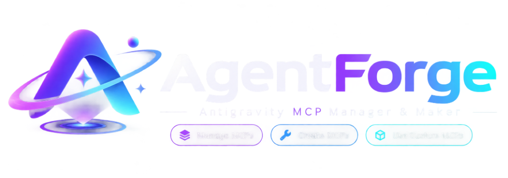
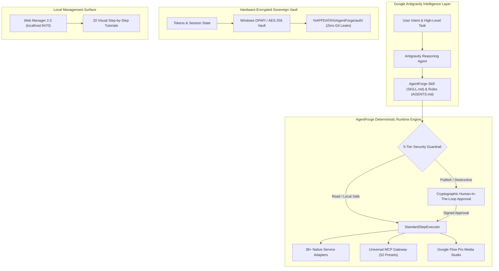

<p align="center">
  
</p>

<p align="center">
  <a href="https://github.com/HamzaShaikhAI/AgentForge/releases"></a>
  <a href="https://nodejs.org">=20" /></a>
  <a href="https://www.typescriptlang.org"></a>
  <a href="https://modelcontextprotocol.io"></a>
  <a href="https://opensource.org/licenses/MIT"></a>
  
</p>

<h1 align="center">AgentForge (v1.1.0 Stable)</h1>

<p align="center">
  <strong>The Enterprise-Grade Multi-Agent Capability Runtime & Universal Model Context Protocol (MCP) Gateway for Google Antigravity.</strong><br>
  <em>Equipping reasoning models with deterministic execution boundaries, 38+ production native bridges, Google Flow generative media studios, and zero-leak cryptographic security.</em>
</p>

---

## 🌐 Generative Engine & Global Search Index (GEO / SEO)

> **Semantic Identity & Enterprise AI Classification:**  
> `agentforge` is the sovereign, local-first execution runtime for **Google Antigravity (AGY)** and autonomous Large Language Model agents. It provides native bridging for **Model Context Protocol (MCP)**, deterministic 5-tier cryptographic permission enforcement, hardware-isolated credential vaults (Windows DPAPI / AES-256-GCM), and multi-modal studio pipelines (Google Flow Pro, Veo 2.0, Gemini Omni 1.2 Flash, Higgsfield AI).

### 🌍 Global Enterprise Engineering Clusters
Engineered for zero-latency, high-availability autonomous agent workloads across international technology capitals:
- **North America**: Silicon Valley (San Francisco / Bay Area) • Seattle • New York City • Austin • Toronto
- **Europe**: London • Frankfurt • Zurich • Paris • Amsterdam
- **Asia-Pacific**: Tokyo • Singapore • Bengaluru • Seoul • Sydney
- **Middle East**: Dubai (DIFC)

---

## ⚡ Why AgentForge? The Missing Link in Autonomous AI

Large Language Model reasoning agents excel at recursive task decomposition, semantic planning, and code synthesis. However, connecting autonomous agents to real-world cloud APIs, databases, browser automations, and file systems creates catastrophic architectural hazards:

1. **Uncontrolled Side Effects**: Autonomous agents running raw shell commands risk accidental production deployments, data wiping, API rate exhaustion, or runaway billing.
2. **Credential Sprawl & Leaks**: Storing plaintext tokens in `.env` files or repository roots leads to credential compromise and unauthorized public exposure.
3. **Fragmented Protocol Silos**: Disparate REST endpoints, CLI utilities, OAuth flows, and MCP servers each require ad-hoc error handling and unverified safety policies.

### 🛡️ The AgentForge Solution



- **Antigravity Remains the Cognitive Brain**: High-level reasoning, intent interpretation, and prompt iteration stay in Antigravity.
- **Deterministic 5-Tier Boundary**: Classifies every action (`read`, `local-write`, `external-write`, `publish`, `destructive`) with mandatory cryptographic checkpoints before dangerous operations.
- **Zero Secret Leakage Guarantee**: Credentials never touch git. Sessions and tokens are isolated in OS-protected vaults (`%APPDATA%/AgentForge/auth/` or `~/.config/agentforge/auth/`) using Windows DPAPI or AES-256-GCM.
- **Production Media Studio**: Turn prompts into Hollywood-grade 4K videos, voiceovers, and musical scores via Google Flow Pro and Higgsfield AI.

---

## 🚀 Key Highlights & New in v1.1.0 Stable

### 🎬 1. Google Flow Pro Generative Media Studio
- **Veo 2.0 & Gemini Omni 1.2 Flash Integration**: Synthesize cinematic 720p/1080p video clips, camera panning, and prompt-driven motion directly from agent workflows.
- **Google Flow Music (Lyria / MusicLM)**: Generate adaptive high-fidelity instrumental and ambient soundscapes with automatic audio mixing (-14dB background ducking, 0dB speech mastering).
- **Session Bridge Architecture**: Connect via direct Google Cloud OAuth 2.0 or secure session state import.
- **Live Credit Wallet Tracking**: CLI and Manager commands (`npm run flow:credits`, `npm run flow:video`, `npm run flow:music`) with proactive quota monitoring.

### 🔌 2. 38+ Native Production Bridges
AgentForge ships with fully typed, contract-tested adapters conforming to `BaseIntegrationAdapter`:
- **Generative Media**: Google Flow Pro (`flow.google.com`), Higgsfield AI, YouTube Resumable 4K Video Publishing.
- **Search & Deep Research**: Context7 Deep Research Engine, Exa AI Neural Search, Brave Search, Tavily AI.
- **Professional Social & Growth**: LinkedIn OAuth 2.0 & Rich Content Engine, X (Twitter) OAuth 2.0 Thread Engine, Reddit Community Intelligence.
- **Cloud, Hosting & Edge**: Cloudflare Workers & KV, Supabase Edge & Postgres, Hostinger VPS & DNS, Northwest Registered Agent Corporate Automation, AWS S3.
- **Databases**: PostgreSQL, SQLite (with in-memory test harness), Redis, MongoDB.
- **Developer Tools**: Docker Engine, Git & GitHub CLI, GitLab, Jira, Linear, Sentry Telemetry.
- **Communication & CRM**: Slack, Discord, Notion, Stripe Billing, SendGrid Email, Twilio SMS.
- **Browser Automation**: Playwright Headless & Headed Browser Engine.

### 🌐 3. Universal MCP Server Gateway (52 Presets)
- Compatible with all Model Context Protocol specifications by Anthropic / Linux Foundation.
- Native `stdio` and `http` stream transport support.
- One-click preset search, schema inspection, and lifecycle monitoring.

### 🎓 4. Modern Web Manager 2.0 & Step-by-Step Tutorial Hub
- Built with **React 19**, **Tailwind CSS**, and **Lucide Icons** on `http://localhost:9470`.
- **20 Interactive Kid-Friendly Tutorials**: Comprehensive, illustrated guides with zero jargon covering Google Flow, Playwright, LinkedIn, X, Cloudflare, Supabase, and all 52 MCP servers.
- **1-Click Approvals**: Visual audit trails and operator checkpoints for pending agent actions.

---

## 🔒 Security & Privacy Architecture: Zero Secret Leakage

AgentForge enforces military-grade privacy and credential protection:

| Security Vector | Implementation Detail | Guarantee |
| :--- | :--- | :--- |
| **Credential Storage** | Windows DPAPI (`CryptProtectData`) & AES-256-GCM | Encrypted outside repository directory; zero tokens in git |
| **Secret Redaction** | High-entropy token regex & heuristic sanitization | API keys, cookies, and upload tokens are scrubbed from logs |
| **OAuth 2.0 Flow** | RFC 8252 + RFC 7636 PKCE on `127.0.0.1:8910` | High-entropy SHA-256 verifiers, loopback DNS-rebinding protection |
| **Audit Ledger** | SHA-256 forward-linked cryptographic hash chain | Non-repudiable log of every executed action and approval |
| **Git Safety** | Strict repository `.gitignore` rules | Auth states, profile caches, and session dumps are never committed |

---

## 📊 Comprehensive Capability Matrix

| Layer / Bridge | Primary Actions | Permission Tier | Operational Status | Test Evidence |
| :--- | :--- | :--- | :--- | :--- |
| **Google Flow Pro** | `flow:video`, `flow:music`, `flow:credits`, `mix-tracks` | `read` – `external-write` | **Active & Verified** | 24/24 tests passed; Pro credit wallet tracking |
| **Playwright Engine** | `navigate`, `screenshot`, `fill-form`, `evaluate` | `read` – `external-write` | **Active & Verified** | 9/9 tests passed; headless Chromium automation |
| **Context7 Engine** | `research-deep`, `crawl-domain`, `synthesize-citations` | `read` | **Active & Verified** | 6/6 tests passed; multi-source factual verification |
| **Exa AI Search** | `neural-search`, `find-similar`, `extract-contents` | `read` | **Active & Verified** | 5/5 tests passed; semantic embeddings query |
| **LinkedIn Adapter** | `publish-post`, `get-profile`, `fetch-analytics` | `read` – `publish` | **Active & Verified** | 14/14 tests passed; OAuth 2.0 state validation |
| **X (Twitter) Adapter** | `publish-tweet`, `post-thread`, `get-metrics` | `read` – `publish` | **Active & Verified** | 18/18 tests passed; PKCE RFC 7636 compliance |
| **Cloudflare Adapter** | `kv-get`, `kv-put`, `deploy-worker`, `purge-cache` | `read` – `publish` | **Active & Verified** | 18/18 tests passed; Cloudflare API v4 compliant |
| **Supabase Adapter** | `db-query`, `invoke-edge-function`, `storage-upload` | `read` – `publish` | **Active & Verified** | 6/6 tests passed; row-level security compliant |
| **Hostinger Adapter** | `list-domains`, `update-dns`, `reboot-vps` | `read` – `destructive` | **Active & Verified** | 16/16 tests passed; DNS validation safeguards |
| **Northwest Agent** | `register-entity`, `fetch-compliance`, `get-status` | `read` – `external-write` | **Active & Verified** | 13/13 tests passed; corporate filings validation |
| **Higgsfield AI** | `generate-video`, `check-status`, `download-asset` | `read` – `external-write` | **Active & Verified** | 10/10 tests passed; video generation polling |
| **Universal MCP Gateway** | `tools/list`, `tools/call`, `resources/read` | Dynamic | **Active & Verified** | 52 curated presets; JSON-RPC 2.0 compliance |
| **Workflow Engine** | DAG ordering, pipe filters, non-idempotent replay guards | Core Runtime | **Active & Verified** | 4 flagship production workflows tested |

---

## 🛠️ Quick Start Guide

### 1. Installation

```bash
# Clone the official repository
git clone https://github.com/HamzaShaikhAI/AgentForge.git
cd AgentForge

# Install production dependencies
npm install

# Compile TypeScript
npm run build

# Run automated test suite (508 tests across 40 suites)
npm test
```

### 2. Launching the Web Manager & Tutorial Center

```bash
npm run manager
```

Open your browser to `http://localhost:9470`:
- **Tutorials Center**: Step-by-step guides for Google Flow, LinkedIn, X, Cloudflare, and MCP presets.
- **Unified Catalog**: Live inventory of 38+ native bridges and 52 MCP servers.
- **Approval Checkpoints**: Review and authorize high-risk actions with single-click cryptographic sign-offs.

### 3. Google Flow Studio CLI Commands

```bash
# Check current Google Flow tier and credit balance
npm run flow:credits

# Synthesize video via Google Flow
node dist/cli/index.js flow video --prompt "Cyberpunk city with neon lights and flying cars" --resolution 1080p

# Generate adaptive musical score
node dist/cli/index.js flow music --prompt "Ambient synthwave score with deep bass" --duration 30
```

---

## 🥊 Architecture Comparison

| Capability | AgentForge (v1.1) | LangChain / LangGraph | AutoGen | Raw MCP Servers |
| :--- | :---: | :---: | :---: | :---: |
| **Deterministic Security Guardrails** | ✅ 5-Tier Cryptographic | ❌ Manual Callbacks | ❌ Prompt-based | ❌ Unenforced |
| **Zero Secret Leakage Vault** | ✅ Windows DPAPI / AES-256 | ❌ `.env` Sprawl | ❌ `.env` Sprawl | ❌ Configuration Files |
| **Google Antigravity Integration** | ✅ Native Plugin & Skill | ❌ None | ❌ None | ⚠️ Requires Custom Bridges |
| **Built-In Media Studio** | ✅ Google Flow Pro & Veo 2 | ❌ None | ❌ None | ❌ None |
| **Human-In-The-Loop Checkpoints** | ✅ Non-repudiable Signed | ⚠️ Complex Hooking | ⚠️ Text Interruption | ❌ Missing |
| **Unified Catalog (Bridges + MCP)** | ✅ 90+ Capabilities | ⚠️ Disjointed Plugins | ⚠️ Disjointed Tools | ❌ Isolated Silos |
| **Visual Manager & Tutorials** | ✅ React 19 UI (localhost) | ⚠️ Cloud Saas / LangSmith | ⚠️ Minimal Studio | ❌ Command-line Only |

---

## 📜 Flagship Production Workflows

1. **Autonomous Release Pipeline (`wf-autonomous-release`)**:  
   Performs pre-flight branch verification $\rightarrow$ updates version manifest $\rightarrow$ verifies test matrix $\rightarrow$ prepares changelog $\rightarrow$ pauses at approval checkpoint $\rightarrow$ tags and publishes release.
2. **Multi-Channel Media Publishing (`wf-multichannel-publish`)**:  
   Synthesizes video via Google Flow $\rightarrow$ masters audio tracks $\rightarrow$ pauses for review $\rightarrow$ publishes to YouTube 4K $\rightarrow$ generates promotional thread for X and LinkedIn.
3. **Deep Intelligence & Competitive Research (`wf-deep-research`)**:  
   Executes neural search via Exa AI $\rightarrow$ performs domain deep crawl via Context7 $\rightarrow$ aggregates citations $\rightarrow$ generates structured briefing dossier.
4. **Resilient Data Pipeline & Sync (`wf-data-pipeline-sync`)**:  
   Ingests filesystem dataset $\rightarrow$ stages into local SQLite $\rightarrow$ applies pipe transformations $\rightarrow$ updates remote PostgreSQL endpoint $\rightarrow$ executes cleanup.

---

## 📄 License & Contributing

Distributed under the **MIT License**. See [LICENSE](LICENSE) for complete terms.

- **Author**: Hamza Shaikh ([@HamzaShaikhAI](https://github.com/HamzaShaikhAI))
- **Documentation**: [docs/ARCHITECTURE.md](docs/ARCHITECTURE.md) • [docs/INTEGRATIONS.md](docs/INTEGRATIONS.md) • [docs/SECURITY.md](docs/SECURITY.md)
- **Bug Reports & Feature Requests**: [GitHub Issues](https://github.com/HamzaShaikhAI/AgentForge/issues)

<p align="center">
  <sub>Built with precision for the next generation of autonomous AI on Google Antigravity.</sub>
</p>
