# AgentForge System Architecture

AgentForge is an extensible capability and workflow harness built specifically for **Google Antigravity**. Rather than attempting to replace Antigravity or act as an autonomous reasoning agent, AgentForge serves as the deterministic execution, security, and integration runtime.

---

## 1. Architectural Philosophy

1. **Antigravity Reasoning, AgentForge Execution:** Antigravity handles high-level cognitive reasoning, planning, and user dialogue. AgentForge handles structured manifest discovery, external MCP connections, deterministic permission gating, durable workflow execution, and credential encryption.
2. **Local-First & OS-Protected:** All credentials, tokens, and authorization states are stored locally on the user's host machine using OS-native encryption (Windows DPAPI with AES-256-GCM fallback). No centralized broker or telemetry server is used.
3. **Deterministic Approval Boundaries:** Actions with external or destructive side effects cannot execute without an explicit, verifiable operator approval bound to the exact inputs and action.

---

## 2. High-Level System Architecture

```mermaid
flowchart TD
    subgraph AntigravityHost["Google Antigravity Host"]
        User["User Prompt"] --> Agent["Antigravity Reasoning Agent"]
        Agent --> PluginSkill["AgentForge Skill (SKILL.md)"]
        Agent --> PluginRules["Safety Rules (rules/AGENTS.md)"]
        Agent --> PluginManifest["Plugin Manifest (plugin.json)"]
    end

    subgraph AgentForgeHarness["AgentForge Core Harness"]
        PluginSkill --> Registry["BridgeRegistry"]
        PluginRules --> Perms["PermissionManager"]
        Agent --> WorkflowEngine["WorkflowEngine"]

        Registry --> Catalog["Unified Catalog Engine"]
        WorkflowEngine --> Perms
        WorkflowEngine --> StepRouter["StandardStepExecutor"]

        StepRouter --> GitExec["GitExecutor (Local Git CLI)"]
        StepRouter --> YouTubeExec["YouTubeExecutor (Data API v3)"]
        StepRouter --> McpRouter["McpManager (External MCP Tools)"]
        StepRouter --> CustomRouter["Custom Bridge Executors"]

        Builder["BridgeBuilder"] --> Analyzer["SecurityAnalyzer"]
        Builder --> Sandbox["Isolated Sandbox Tests"]
        Builder --> Registry
    end

    subgraph SecurityAndAuth["Security & Authentication Subsystem"]
        OAuth["GoogleOAuthService (RFC 8252 PKCE)"] --> Callback["Loopback Server (127.0.0.1:8910)"]
        OAuth --> DPAPI["Windows DPAPI / Encrypted Store"]
        DPAPI --> Storage["%APPDATA%/AgentForge/auth/ (Outside Repo)"]
        Redact["Security Redaction Engine"] --> WorkflowEngine
        Redact --> OAuth
        Redact --> YouTubeExec
    end

    subgraph ManagerInterface["Local Manager Dashboard"]
        Server["Manager HTTP Server (Port 9470)"] --> Dashboard["manager/index.html UI"]
        Server --> Registry
        Server --> Catalog
        Server --> WorkflowEngine
        Server --> OAuth
        Server --> McpRouter
        Server --> Builder
    end

    subgraph ConnectedEndpoints["External Services & Endpoints"]
        GitExec --> LocalGit["Local Git CLI"]
        YouTubeExec --> YouTubeAPI["YouTube Data API v3"]
        McpRouter --> StdioMcp["Stdio MCP Processes"]
        McpRouter --> HttpMcp["Remote SSE/HTTP MCP Servers"]
    end
```

---

## 3. Subsystem Breakdown

### 3.1 Bridge Registry & Validator (`src/bridge-registry.ts`, `src/bridge-validator.ts`)
- Discovers and loads bridge manifests (`bridge.json`) conforming to schema `"1.0"`.
- Validates identity, capabilities, permissions, integrations, authentication requirements, and smoke tests.
- Rejects malformed manifests with granular schema errors.

### 3.2 Permission Engine (`src/permissions.ts`)
Evaluates actions against a 5-tier permission model:
- `read`: Unrestricted inspection of local/public state.
- `local-write`: Modification of non-destructive local files (allowed by default).
- `external-write`: Modifications to external systems (requires approval).
- `publish`: Public release of content, packages, or videos (requires approval).
- `destructive`: Irreversible state alterations (requires explicit approval).

### 3.3 Workflow Orchestration Engine (`src/workflow-engine.ts`)
- **Step Dependency Graph:** Resolves execution order across linear and DAG dependencies.
- **Dynamic Step References:** Resolves `$steps.<id>.output.<field>` and `{{steps.<id>.output.<field>}}` templates with structured value preservation.
- **Durable Approval Checkpoints:** Halts on gated steps (`paused_for_approval`), verifying that approval matches exact input hashes and operator identity.
- **Cancellation & Retries:** Bounded retries for idempotent steps and cooperative cancellation via `AbortController`.
- **Safe Persistence:** Persists runs to disk while redacting sensitive tokens and credentials.

### 3.4 Google OAuth & Credential Storage (`src/auth/`)
- **Direct Native Desktop Client (RFC 8252):** Connects directly from native loopback (`http://127.0.0.1:8910/callback`) to Google with SHA-256 PKCE code challenges (`RFC 7636`).
- **Zero-Config Publisher Resolution:** Resolves client ID from bundled `publisher-client.json` or release constants without requiring user environment variables.
- **Placeholder Detection:** Strictly blocks dummy client IDs from starting broken OAuth flows.
- **OS-Protected Storage:** Encrypts tokens using Windows DPAPI (`WindowsDpapiCredentialStore`) or `AES-256-GCM` (`EncryptedFileCredentialStore`), writing strictly outside the repository to `%APPDATA%\AgentForge\auth\` or `~/.config/agentforge/auth/`.
- **Automatic Secret Redaction:** Scrubbing engine strips tokens (`ya29.*`, `1//*`), secrets (`GOCSPX-*`), and upload session IDs from logs, API responses, and errors.

### 3.5 External MCP Manager (`src/mcp/`)
- Manages connections to external Model Context Protocol (MCP) servers via `stdio` or `sse`/`http`.
- Performs protocol handshake (`initialize`, `ping`, `tools/list`, `tools/call`).
- Automatically infers permission levels for tools based on tool names and descriptions.
- Exposes tools to workflows using the `mcp:<server_id>` prefix.

### 3.6 Custom Bridge Builder (`src/builder/`)
- Generates bridge manifests and TypeScript executors from natural language specifications.
- Employs a static security analyzer to block `eval()`, shell injection, path traversal, and hardcoded secrets.
- Validates generated bridges by running isolated unit tests in sandbox directories.
- Enforces an approval barrier before promoting staged bridges to active status.

### 3.7 Local Manager Dashboard (`src/manager/`)
- Runs a local loopback HTTP server (`http://localhost:9470`) serving a CSS-tokenized, dark/light responsive dashboard (`manager/index.html`).
- Enforces host and origin security to block unauthorized cross-site requests and DNS rebinding attacks.
- Provides visual controls for bridges, catalog search, workflow runs, approval checkpoints, OAuth status, and custom bridge generation.

### 3.8 Native Service Adapters Framework (`src/adapters/`)
- Standardized on `BaseIntegrationAdapter` abstract class enforcing health checks, schema validation, action execution, and permission levels.
- Provides 25 native production adapters covering Filesystem, HTTP, SQLite, Git, YouTube, Docker, Cloudflare, AWS S3, PostgreSQL, Redis, MongoDB, Slack, Discord, Notion, Jira, Linear, Sentry, Stripe, Twilio, SendGrid, Brave Search, Tavily, and Working Memory.
- Auto-registers with `StandardStepExecutor` for zero-overhead workflow action dispatch.

### 3.9 Platform Features & Truth Foundation (`src/truth/`, `src/audit/`, `src/triggers/`, `src/governance/`)
- **CapabilityTruthEngine:** Performs ground-truth inspection of host PATH binaries, bridge health, and active server connections.
- **AuditChain:** Forward-linked cryptographic ledger using SHA-256 to ensure log integrity and tamper detection.
- **Webhook Ingress:** Timing-safe HMAC signature verification (`crypto.timingSafeEqual`) for secure external triggers.
- **Governance:** Token-bucket rate limiters and scoped, time-bounded delegation tokens.
- **Step Debugger & Skill Generator:** Interactive workflow breakpoint stepping and auto-generated Antigravity skill definitions.
