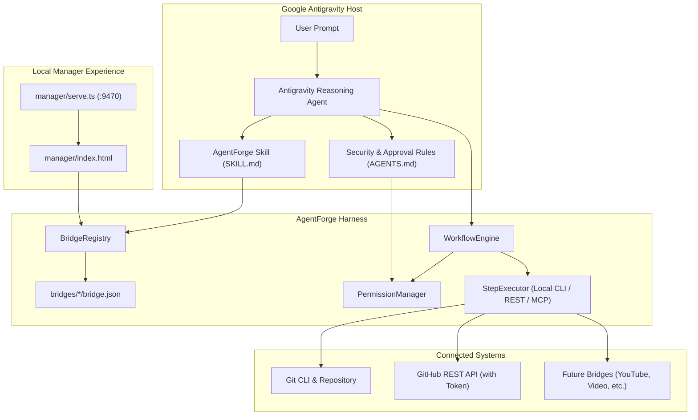

# AgentForge Architecture Notes

## Overview

AgentForge is an extensible capability harness built specifically for Google Antigravity. Rather than attempting to be an independent agent framework, AgentForge augments Antigravity by providing:
1. Structured, versioned **Bridge Manifests** (`bridge.json`) describing third-party services and tools.
2. A deterministic **Permission & Approval Engine** enforcing tiers of side effects (`read`, `local-write`, `external-write`, `publish`, `destructive`).
3. A lightweight **Workflow Engine** coordinating multi-step procedures with dependency management and retry handling while leaving cognitive reasoning to Antigravity.
4. A **Local Manager Dashboard** serving as a web portal for bridge discovery, status inspection, and manifest creation.
5. An Antigravity **Plugin Package** exposing a dedicated skill (`SKILL.md`), always-on safety rules (`rules/AGENTS.md`), and plugin manifest (`plugin.json`).

---

## System Diagram

---

## Core Components

### 1. Antigravity Plugin Integration
- **`plugin.json`**: Standard Antigravity plugin manifest defining name, description, and suggested prompts.
- **`skills/agentforge/SKILL.md`**: Provides progressive disclosure instructions guiding Antigravity on discovering bridges, diagnosing missing integrations without fabricating capabilities, and enforcing approval barriers.
- **`rules/AGENTS.md`**: Directory/plugin-level invariants strictly preventing unapproved external publishing, secret leakage, or hallucinated results.

### 2. Bridge Manifest Schema (`schema: "1.0"`)
Every bridge manifest (`bridge.json`) defines:
- **Identity & Metadata**: `name`, `displayName`, `version`, `category`, `description`.
- **Capabilities**: Available actions, parameters, output schemas, and required permission tier.
- **Integrations**: Prerequisites (commands, env vars, MCP servers) with verification checks and setup instructions.
- **Authentication**: Token and credential requirements, explicitly referenced by environment variable name without storing secret strings.
- **Permissions**: Mapping of actions to approval requirements (`read`, `local-write`, `external-write`, `publish`, `destructive`).
- **Testing**: Smoke test command and verification steps.

### 3. Permission & Approval Tiers
Permissions are evaluated hierarchically:
1. `read`: Unrestricted reading of public/local metadata.
2. `local-write`: Modification of local non-destructive artifacts.
3. `external-write`: Network operations altering external states (requires approval).
4. `publish`: Releasing publicly visible content or tags (requires approval).
5. `destructive`: Irreversible actions (requires explicit confirmation).

### 4. Workflow Execution & Truthful Reporting
The `WorkflowEngine`:
- Enforces linear and DAG dependencies across steps.
- Halts execution when a step transitions to `waiting-approval`, demanding explicit user intervention.
- Employs bounded retries only when explicitly configured on a step.
- Captures granular timestamps, execution status, and verbatim error strings without obscuring failures.

### 5. UI Architecture: Embedded vs Standalone Manager
Antigravity officially supports custom generative UI artifacts (HTML with Tailwind CSS rendered inline via `<agent-embed>` or as side-pane artifacts), but does not offer arbitrary native internal tab extensions. AgentForge accordingly provides:
- **Standalone Local Dashboard**: A lightweight Node.js HTTP server (`src/manager/serve.ts`) serving `manager/index.html` on port 9470 with REST endpoints (`/api/bridges`).
- **Inline Generative UI Compatibility**: The dashboard HTML is structured with Tailwind CSS and semantic CSS variables to allow packaging as an inline Antigravity embed if desired.
