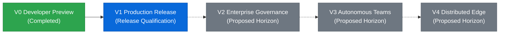

# AgentForge Product Roadmap & Milestone Lifecycle

This document outlines the versioned progression of AgentForge from its initial developer preview (V0) through current production readiness (V1) and proposed future horizons (V2–V4).

---

## Semantic Versioning & Stability Contract

AgentForge strictly adheres to [Semantic Versioning 2.0.0](https://semver.org/):
- **MAJOR (X.0.0):** Breaking changes to bridge manifest schemas (`schema: "1.0"`), permission classification rules, workflow step reference syntax, or CLI command invocations.
- **MINOR (0.X.0 / 1.X.0):** Backwards-compatible additions, new native adapters, new universal MCP presets, new workflow engine capabilities, or Manager dashboard enhancements.
- **PATCH (0.0.X / 1.0.X):** Backwards-compatible bug fixes, security patches, documentation refinements, and performance improvements.

---

## Release Progression Overview

---

## Milestone Details

### V0 — Developer Preview (Completed)
- **Baseline Git Commit:** `05e37de` (`feat: prepare AgentForge V0 developer preview`)
- **Status:** Shipped and verified in Git history.
- **Key Deliverables:**
  - Core integration harness and bridge manifest validator (`BridgeValidator`).
  - Deterministic 5-tier permission model (`read`, `local-write`, `external-write`, `publish`, `destructive`).
  - Native Git CLI executor (`repo-info`, `status-check`, `branch-list`, `log-inspect`, `diff-review`).
  - Local single-page Manager UI (`manager/index.html`) on port 9470.
  - Antigravity integration assets: plugin manifest (`plugin.json`), agent rules (`rules/AGENTS.md`), and skill (`skills/agentforge/SKILL.md`).

---

### V1 — Production Platform & Verification Gate (Current Target)
- **Target Git Commit:** Staged for verification (`1.0.0` target).
- **Status:** **Release Candidate Qualified** — 326/326 tests passing, independent verification completed in `docs/V1_FINAL_VERIFICATION.md`.
- **Key Deliverables:**
  - **Universal MCP Presets:** 52 curated presets across 12 distinct categories with stdio and http transport support.
  - **25 Native Production Adapters:** Built on `BaseIntegrationAdapter` covering Filesystem, HTTP, SQLite, Git, YouTube, Docker, Cloudflare, S3, PostgreSQL, Redis, MongoDB, Slack, Discord, Notion, Jira, Linear, Stripe, and search providers.
  - **15 Platform Features:** Dynamic step conditions, pipe filters, environment variable interpolation, step timeout overrides, cancellation cleanup hooks, dry-run mode, cryptographic audit hash chains (SHA-256), webhook ingress triggers, token bucket rate limiting, scoped delegation tokens, encrypted vault backups, adapter health monitoring, interactive step debugging, Antigravity skill generation, and structured run artifacts.
  - **4 Flagship Production Workflows:** Autonomous Release Pipeline, Multi-Channel Publishing, Incident Response & Triage, Data Pipeline & Sync.
  - **Manager Dashboard Redesign:** Dark/light token theme, 12 operational views, full REST API integration.
  - **Zero-Config Google Sign-In & Security:** RFC 8252 loopback authorization with SHA-256 PKCE, secret redaction, and Windows DPAPI encrypted credential storage.
- **External Prerequisites:** Live zero-config Google sign-in awaits publisher OAuth client registration in Google Cloud Console.

---

### V2 — Multi-Tenant Governance & Policy Engine (Proposed Horizon)
*Proposed future milestone — dates and detailed commitments to be defined after V1 community adoption.*
- **Themes & Capabilities:**
  - **Open Policy Agent (OPA) / Rego Integration:** Declarative organization-level security policies evaluated before step dispatch.
  - **Multi-Tenant Profile Isolation:** Separation of credential vaults and bridge registrations across multiple local or team user profiles.
  - **Remote Approval Ingress:** Signed webhooks and mobile push callbacks for approval checkpoints without requiring active browser sessions.
  - **Hardware Security Module (HSM) & FIDO2:** YubiKey / WebAuthn hardware token confirmation for destructive and publishing operations.
  - **Native macOS & Linux Keychains:** Direct integration with macOS Keychain Services and Linux SecretService API.

---

### V3 — Collaborative Multi-Agent Mesh & Swarm Coordination (Proposed Horizon)
*Proposed future milestone.*
- **Themes & Capabilities:**
  - **Agent-to-Agent Bridge Negotiation:** Dynamic capability negotiation allowing multiple Antigravity peer agents to coordinate workflows across distinct host nodes.
  - **Distributed Step Execution:** Distributed DAG execution across trusted local subnet nodes with mTLS mutual authentication.
  - **Real-Time Canvas & Graph Visualizer:** Interactive graphical workflow builder with live DAG node execution states.
  - **Automated Capability Fuzzing:** Continuous contract fuzz testing for third-party MCP servers to automatically catch upstream breaking changes.

---

### V4 — Decentralized & Distributed Edge Fabric (Proposed Horizon)
*Proposed future milestone.*
- **Themes & Capabilities:**
  - **Zero-Trust Edge Gateways:** Headless, resource-constrained AgentForge runtimes for IoT, edge devices, and remote servers.
  - **P2P Encrypted Mesh:** Peer-to-peer capability discovery and decentralized workflow synchronization using libp2p.
  - **Self-Healing Automation:** Autonomous workflow compensation and intelligent self-healing for transient infrastructure faults.
