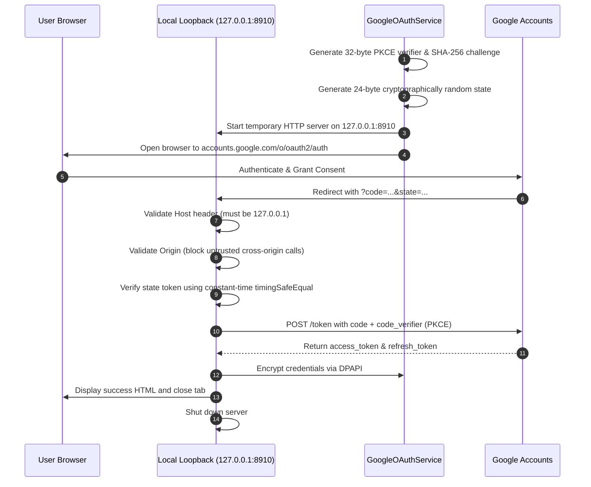
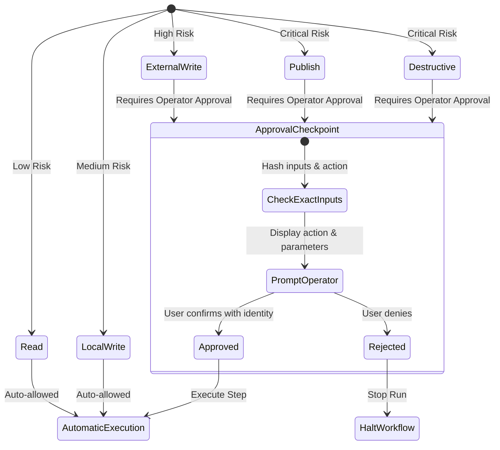

# AgentForge Security & Trust Architecture

AgentForge is designed around strict local-first security invariants. This document provides a comprehensive breakdown of our threat model, encryption standards, permission enforcement, and sandbox boundaries.

---

## 1. Threat Model & Design Principles

| Principle | Implementation | Guarantee |
|---|---|---|
| **Zero External Proxies** | Direct native connections to third-party APIs | Your OAuth tokens, code, and user data never pass through an AgentForge intermediary server. |
| **OS-Protected Credential Storage** | Windows DPAPI / AES-256-GCM encrypted file store | Credentials cannot be decrypted by unauthorized users or copied off-disk in plaintext. |
| **Deterministic Permission Gating** | 5-tier permission model evaluated before execution | Destructive or publishing operations halt and require explicit operator confirmation. |
| **Deep Redaction Engine** | Regex and key-based scrubbing across all outputs | Tokens, auth codes, and secrets are stripped from logs, API responses, and errors. |
| **Tamper-Evident Approvals** | Argument hash and operator identity binding | Approvals cannot be bypassed or replayed if input arguments are tampered with. |

---

## 2. Credential Encryption & Storage

AgentForge stores authentication credentials strictly outside the source code repository.

### 2.1 Storage Directory Hierarchy
- **Windows:** `%APPDATA%\AgentForge\auth\` (e.g., `C:\Users\<user>\AppData\Roaming\AgentForge\auth\`)
- **macOS / Linux:** `~/.config/agentforge/auth/`
- **Environment Override:** `AGENTFORGE_CREDENTIALS_DIR` (used in tests to enforce complete sandbox isolation)

### 2.2 Windows Data Protection API (DPAPI)
On Windows systems, AgentForge uses `WindowsDpapiCredentialStore`:
- Encryption is performed via `System.Security.Cryptography.ProtectedData.Protect()` using the `CurrentUser` scope.
- Decryption is tied cryptographically to the logged-in Windows user's credentials and system master key.
- Other user accounts or remote machines copying the `.dat` file cannot decrypt the contents.
- Data is passed to PowerShell DPAPI workers via `stdin` to prevent exposure in process listing tables.

### 2.3 Non-Windows Fallback: AES-256-GCM
On Linux and macOS, `EncryptedFileCredentialStore` is used:
- Key derivation: `scryptSync` with a unique 16-byte cryptographic salt per file.
- Encryption cipher: `aes-256-gcm` with a random 12-byte initialization vector (IV) and 16-byte authentication tag.
- File permissions are set to `0600` (readable and writable only by the current user).

---

## 3. Native Desktop OAuth 2.0 Security (RFC 8252 & RFC 7636)

AgentForge implements the IETF Best Current Practice for native OAuth 2.0 applications:

### Key Native Security Protections:
1. **Loopback IP Address:** Bound strictly to `127.0.0.1`.
2. **DNS Rebinding Protection:** The server explicitly inspects the HTTP `Host` header and rejects requests if the host is not `127.0.0.1`, `localhost`, or `[::1]`.
3. **Cross-Origin Protection:** Cross-origin POST or GET requests from untrusted browser origins are rejected with HTTP 403.
4. **Replay & Re-entry Guards:** The loopback server processes exactly one callback and rejects repeated requests with HTTP 409 Conflict.
5. **Constant-Time State Verification:** State comparison uses `crypto.timingSafeEqual` to eliminate timing side-channel attacks.

---

## 4. Permission Gating & Approval Checkpoints

AgentForge enforces a deterministic 5-tier classification model:

### Approval Invariants:
- **Binding to Arguments:** An approval granted for `video-upload` with `title: "Demo 1"` cannot be applied to `title: "Demo 2"`. Any change to input parameters invalidates the approval.
- **Identity Binding:** Approvals require an explicit `approvedBy` identity string (e.g. operator username), which is recorded in the permanent audit trail.
- **Direct Dispatch Protection:** Direct invocation of dangerous actions through MCP tools or REST API endpoints is strictly prevented from bypassing approval checks.

---

## 5. Secret Redaction Engine

AgentForge runs all workflow outputs, error messages, and log records through `sanitizeErrorString` and `redactObject`:
- **Pattern Scrubbing:**
  - `ya29\.[a-zA-Z0-9_-]+` -> `[REDACTED_ACCESS_TOKEN]`
  - `1\/\/[a-zA-Z0-9_-]+` -> `[REDACTED_REFRESH_TOKEN]`
  - `GOCSPX-[a-zA-Z0-9_-]+` -> `[REDACTED_CLIENT_SECRET]`
  - `4\/[a-zA-Z0-9_-]+` -> `[REDACTED_AUTH_CODE]`
  - `upload_id=[a-zA-Z0-9_\-\.]+` -> `upload_id=[REDACTED_UPLOAD_ID]`
- **Recursive Object Redaction:** Any object key matching `/(token|secret|password|credential|authcode|key)/i` has its value replaced with `[REDACTED]`.
- **Email Masking:** Email addresses are masked (e.g., `d*******r@example.com`) to protect personal identifiable information (PII).

---

## 6. Custom Bridge Builder Security & Sandbox Guarantees

The Custom Bridge Builder automatically validates user-generated bridge code before activation.

### 6.1 Static Security Analyzer
The analyzer scans generated TypeScript code for dangerous constructs:
- ❌ Forbidden `eval()` execution
- ❌ Dynamic `new Function()` creation
- ❌ Unsafe shell interpolation (`child_process.exec` with template literals)
- ❌ Direct shell interpreters (`sh -c`, `cmd /c`)
- ❌ Path traversal patterns (`../`)
- ❌ Hardcoded tokens (`ya29.*`, `ghp_*`, `sk-*`, etc.)

### 6.2 Testing Sandbox Guarantees & Boundaries
- When validating a staged bridge, AgentForge runs unit tests in a separate child process using isolated temporary directories (`vitest.sandbox.config.ts`).
- **Important Limitation:** This is an application-level test runner sandbox, **not** an operating system hypervisor or hardware container. Staged code runs with the permissions of the parent Node.js user process. Untrusted, third-party code must always be reviewed by an operator before approval.
