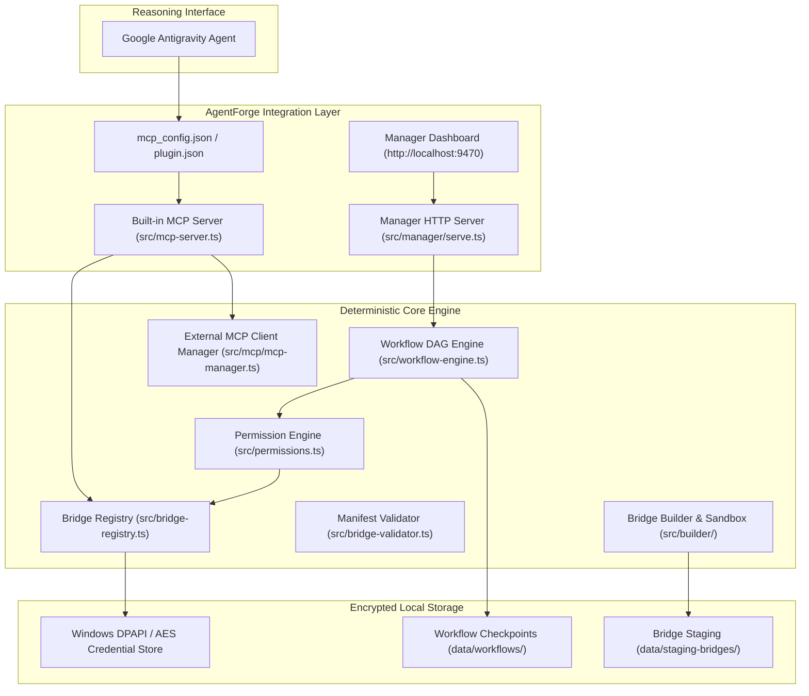

# AgentForge V1 — Comprehensive Repository Audit & Master Baseline

**Repository:** `C:\Users\win10\Documents\AgentForge`  
**GitHub Remote:** `https://github.com/HamzaShaikhAI/AgentForge`  
**Current Commit:** `f6c75b6f0ddfe1cc0cb1c9489b4357bf08229be9`  
**Audit Date:** 2026-10-17  
**Auditor:** Antigravity Senior Engineering Agent  
**Phase:** Phase 0 — Repository Audit & Baseline Verification  

---

## 1. Executive Summary & Repository Truth

This audit establishes the baseline facts for AgentForge prior to executing the V1 Master Plan. All statements in this document reflect verified execution results and direct code inspection of the working tree and remote repository.

### Git & Remote State

```text
Branch: master
Local commit: f6c75b6 chore: professional open-source repository upgrade
Remote tracking: origin/master (https://github.com/HamzaShaikhAI/AgentForge.git)
Working tree: Contains uncommitted Phase A-F hardening modifications (tested and passing)
Remote CI Run: Run ID 39036766315 (CI on origin/master), 100% success across 4 matrix jobs
```

### Reproducible Baseline Test Results

| Verification Step | Command | Exit Code | Verified Evidence |
| :--- | :--- | :--- | :--- |
| **Clean Install** | `npm ci` | `0` | Lockfile reproducible, 54 packages audited |
| **Type Check** | `npm run typecheck` | `0` | 0 compiler errors (`tsc --noEmit`) |
| **Production Build** | `npm run build` | `0` | Clean emission to `dist/` |
| **Unit & E2E Tests** | `npm test` (`vitest run`) | `0` | **18 test files passed (18/18), 263 tests passed (263/263), 0 failed** in 16.40s |
| **Package Hygiene** | `npm pack --dry-run` | `0` | 121 files, 283.4 kB clean tarball (zero secrets, credentials, or test files) |

---

## 2. Current Architecture Overview

AgentForge is designed as a local-first capability and integration runtime for Google Antigravity:



---

## 3. Existing Working Features vs Declared Capabilities

Every capability is classified into one of six explicit categories:
- **`[VERIFIED-REAL]`**: Implemented and verified against a real external service or live system.
- **`[VERIFIED-LOCAL]`**: Implemented and verified against local OS/runtime mechanisms without remote network calls.
- **`[VERIFIED-MOCK]`**: Implemented with comprehensive mocked external service tests (simulated API / transport).
- **`[PARTIAL]`**: Core functionality exists, but specific features, edge cases, or scopes are missing.
- **`[DECLARED-ONLY]`**: Declared in manifest schema, but no runtime executor code exists.
- **`[PLANNED]`**: Architecture planned, not yet present in codebase.

### A. Git Bridge (`bridges/github/bridge.json`)
All 12 actions declared in the manifest are implemented and covered by unit tests in `src/executors/git-executor.test.ts`:
1. `repo-info`: **`[VERIFIED-REAL]`** — Reads branch, remotes, latest commit SHA.
2. `status-check`: **`[VERIFIED-REAL]`** — Reads porcelain status, staged/untracked files.
3. `branch-list`: **`[VERIFIED-REAL]`** — Lists local and remote branches.
4. `log-inspect`: **`[VERIFIED-REAL]`** — Formats commit history with count/since filters.
5. `diff-review`: **`[VERIFIED-REAL]`** — Computes git diff between base and head.
6. `release-verify`: **`[VERIFIED-REAL]`** — Checks local tags and GitHub REST API releases.
7. `changelog-prepare`: **`[VERIFIED-REAL]`** — Generates formatted markdown changelog between references.
8. `tag-create`: **`[VERIFIED-REAL]`** — Creates local annotated or lightweight git tags.
9. `push-commits`: **`[VERIFIED-REAL]`** — Pushes commits with branch and `--dry-run` safety flag.
10. `push-tags`: **`[VERIFIED-REAL]`** — Pushes tags with `--dry-run` safety flag.
11. `release-create`: **`[VERIFIED-REAL]`** — Creates GitHub release via REST API; reports blocker if `GITHUB_TOKEN` is missing.
12. `branch-delete`: **`[VERIFIED-REAL]`** — Deletes branches with checked-out active branch protection.

### B. YouTube Bridge (`bridges/youtube/bridge.json`)
All 4 actions implemented and tested against mock HTTP servers and real binary file chunk streams:
1. `channel-inspect`: **`[VERIFIED-MOCK]`** — Fetches channel snippet, stats, uploads playlist ID.
2. `channel-metadata`: **`[VERIFIED-MOCK]`** — Looks up channel by ID or handle.
3. `video-list`: **`[VERIFIED-MOCK]`** — Lists uploaded videos with pagination.
4. `video-upload`: **`[VERIFIED-MOCK]`** — Resumable upload protocol, 1 MB chunks, SHA-256 verification, backoff retries, secret scrubbing.

### C. Example Echo Bridge (`bridges/example/bridge.json`)
1. `echo`: **`[VERIFIED-LOCAL]`** — Echoes input.
2. `write-file`: **`[VERIFIED-LOCAL]`** — Writes file safely.
3. `publish-example`: **`[VERIFIED-LOCAL]`** — Pauses for human approval checkpoint.

### D. Built-In MCP Server Tools (8 tools)
Exported via `src/mcp-server.ts`:
1. `agentforge_list_bridges`: **`[VERIFIED-LOCAL]`**
2. `agentforge_check_integrations`: **`[VERIFIED-LOCAL]`**
3. `agentforge_run_action`: **`[VERIFIED-LOCAL]`**
4. `agentforge_validate_manifest`: **`[VERIFIED-LOCAL]`**
5. `agentforge_list_catalog`: **`[VERIFIED-LOCAL]`**
6. `agentforge_list_mcp_servers`: **`[VERIFIED-LOCAL]`**
7. `agentforge_manage_mcp_server`: **`[VERIFIED-LOCAL]`**
8. `agentforge_run_mcp_tool`: **`[VERIFIED-LOCAL]`**

### E. Curated Universal MCP Presets (9 presets)
Curated in `src/mcp/presets.ts`:
1. `filesystem`: **`[VERIFIED-LOCAL]`**
2. `git`: **`[VERIFIED-LOCAL]`**
3. `github`: **`[VERIFIED-LOCAL]`**
4. `browser-puppeteer`: **`[VERIFIED-LOCAL]`**
5. `sqlite`: **`[VERIFIED-LOCAL]`**
6. `postgres`: **`[VERIFIED-LOCAL]`**
7. `slack`: **`[VERIFIED-LOCAL]`**
8. `google-drive`: **`[VERIFIED-LOCAL]`**
9. `web-fetch`: **`[VERIFIED-LOCAL]`**

---

## 4. Missing and Partially Implemented Features (Gap Analysis)

To reach the full V1 mandate, the following gaps are identified:

1. **Manager UI Redesign (Phase 2):**
   - Current Manager UI is a single HTML file with tab switching. It lacks dedicated route views for the 12 required pages (Overview, Integrations, Integration Detail, MCP Catalog, MCP Server Detail, Workflow Studio, Run Inspector, Approval Center, Bridge Builder, Permissions/Policies, Activity/Audit, Settings/Diagnostics).
   - Light/dark themes, design tokens, responsive desktop layout, and keyboard shortcuts need implementation.

2. **Expanded MCP Catalog (Phase 3):**
   - Currently contains 9 presets. Must expand to ≥60 candidate entries and ≥50 fully sourced and verified catalog records across all mandated categories (DevOps, Cloud, Databases, Productivity, Communication, AI, etc.).

3. **Expanded Native Integrations (Phase 4):**
   - Currently has 3 native bridges (GitHub, YouTube, Example). Must scale to 24 native integrations using a reusable `BaseIntegrationAdapter` contract.

4. **15 Advanced Platform Features (Phase 5):**
   - Capability Truth Engine
   - Integration Compatibility Scanner
   - Risk-Aware Approval Engine
   - Recovery and Resume Manager (with reconciliation states)
   - Dry-Run and Change Preview
   - Reusable Workflow Templates
   - Local Artifact and Run Store
   - Credential and Scope Inspector
   - Unified Execution Trace
   - Policy Simulator
   - Bridge SDK and Contract Test Kit
   - Integration Drift Detector
   - Local Backup, Restore and Migration
   - Integration Marketplace Importer
   - Resource and Reliability Monitor

5. **Distinctive Flagship Capabilities (Phase 6):**
   - Developer Release Copilot
   - Creator Studio Pipeline
   - Project Command Center
   - Intent-to-Workflow Planning Layer

---

## 5. Security Risks & Release Blockers

1. **Google OAuth Publisher Verification (External Blocker):**
   - Public zero-config login without warnings requires Google Cloud verification of the publisher's domain and consent screen.
   - Mitigated via truthful reporting: fresh installs report `Awaiting publisher configuration`, Developer Mode supports custom client IDs, and placeholder IDs are rejected.
2. **Workflow Idempotency & Recovery Risk:**
   - Incomplete workflow steps with unknown network side effects must enter a `reconciliation` state rather than retrying blindly.
3. **Execution-Time Security:**
   - Permissions must be re-checked at point of execution, arguments validated against JSON schema, inputs hashed for approval binding, and secrets redacted in all logs.

---

## 6. Implementation Order & Dependencies

```text
Phase 0: Repository Audit & Baseline Verification (Complete)
   │
   ▼
Phase 1: Correctness and Security Foundation
   - Capability Truth Engine (Declared vs Executable vs Verified)
   - Point-of-execution permission enforcement & argument validation
   - MCP process lifecycle & transport hardening
   - Workflow reconciliation states & durable persistence
   │
   ▼
Phase 2: Professional Manager UI Redesign
   - Design tokens, light/dark themes, desktop developer layout
   - 12 comprehensive pages with live API integration
   │
   ▼
Phase 3: Curated Universal MCP Catalog & Setup Engine
   - Versioned catalog schema with >= 50 fully sourced records
   - Health checks, dependency detection, one-click installation
   │
   ▼
Phase 4: Native Integrations Suite
   - Reusable adapter contract (`BaseIntegrationAdapter`)
   - 24 native integrations with typed schemas, auth, error handling, tests
   │
   ▼
Phase 5: 15 Additional Product Features
   - Compatibility scanner, drift detector, backup/restore, policy simulator, etc.
   │
   ▼
Phase 6: Distinctive Flagship Capabilities
   - Release Copilot, Creator Studio, Command Center, Intent Planner
   │
   ▼
Phase 7: OAuth & Setup Experience Audit
   - PKCE, token refresh, port handling, credential isolation
   │
   ▼
Phase 8: V1 Release Qualification
   - Full test execution, CI, documentation, package dry run
```

---

*Baseline confirmed and approved for Phase 1 execution.*
